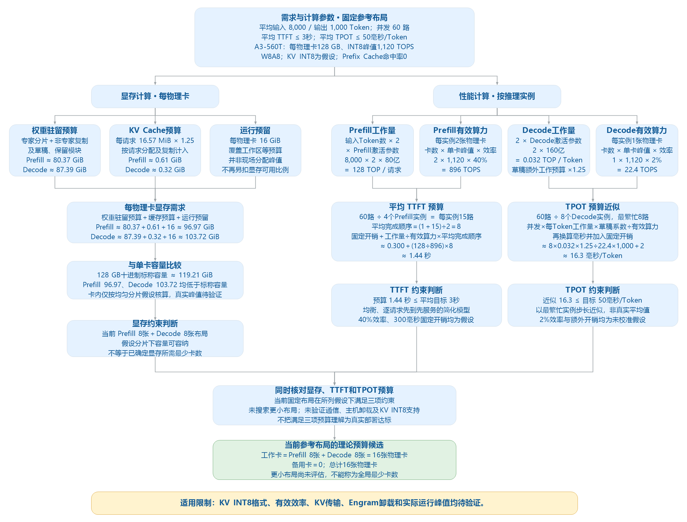

# DeepSeek-V4.1-Flash 推理容量理论预算（V2）

测算日期：2026-10-20。范围：固定参考布局的理论预算，不使用实测性能记录。

[查看流程大图](sizing-flow.svg)

> **当前参考布局的预算候选：16 张 A3-560T 物理卡，Prefill 8 张、Decode 8 张，备用 0 张。更小布局尚未评估。**
>
> 该候选在明确假设下满足所列显存及时延预算；KV INT8 实现、实际通信和运行峰值尚未验证，不能作为部署或时延达标承诺。

## 一、需求与部署条件

| 项目 | 本轮条件 |
| --- | --- |
| 模型、精度与框架 | DeepSeek-V4.1-Flash；W8A8，KV INT8；vLLM Ascend v0.30.0rc1 |
| 平均输入 / 输出 | 8,000 / 1,000 Token，输出包含全部推理 Token |
| 峰值并发与负载 | 60 路同批突发 |
| 平均延迟目标 | TTFT ≤ 3,000 ms；TPOT ≤ 50 ms/Token |
| 部署与硬件 | A3-560T；PD 分离 |
| 增长 / 备用 / Prefix Cache | 0% / 0 组 / 命中率 0 |

### 本轮建模方案

评估范围为固定参考布局：Prefill 配置 8 张物理卡、4 个推理实例，每实例使用 2 张卡；Decode 配置 8 张物理卡、8 个推理实例，每实例使用 1 张卡。推理实例可能通过专家并行共享权重，不等于独占完整模型副本。

调度采用已确认的简化假设：60 路请求均衡分配，Prefill 各实例逐请求先到先服务；Decode 用最繁忙实例的步长近似平均 TPOT。前者为业务突发输入的建模方式，后者为生成阶段性能近似，均不代表真实调度已核验。

参考方案采用 INT8 Engram 主机共享卸载及 5 Token DSpark，不计推测加速收益；KV INT8 按授权的假想格式预算。

### 关键依据与假设

| 项目 | 取值 | 来源与状态 |
| --- | --- | --- |
| Prefill / Decode 激活参数 | 约 80 亿 / 160 亿 | 固定版本官方说明；仅近似线性运算 |
| 单物理卡 INT8 峰值 / 标称内存 | 1,120 TOPS / 128 GB | 官方整机规格推导，非有效性能 |
| Prefill / Decode 峰值折算系数 | 40% / 2% | 本轮沿用授权粗估假设，未实测校准 |
| Prefill / Decode 固定开销 | 300 ms / 2 ms 每 Token | 工程假设，未验证传输与排队是否可被覆盖 |
| 权重附加 / 非专家复制修正 | 10% / ×1.30 | 目标量化及分片的预算近似 |
| KV 格式 / 缓存附加预算 | INT8 值及尺度 / 25% | 假想实现，非已验证部署格式 |
| 每卡运行预留 / 草稿工作系数 | 16 GiB / ×1.25 | 工程假设，不计 DSpark 加速收益 |

## 二、计算规则

### 显存与阶段时延

> 每物理卡显存预算 ≈ 权重驻留预算 ＋ 请求缓存预算 ＋ 运行预留
>
> 权重驻留预算 ≈ 卡内各分片的［专家分片 ＋ 非专家分片及复制 ＋ 保留模块］附加预算之和
>
> 每请求缓存预算 ≈（压缩共享主缓存 ＋ 索引缓存 ＋ 主模型及草稿滑窗）× 缓存附加系数
>
> 单请求 Prefill 工作量 ≈ 输入 Token 数 × 每 Token 的 Prefill 激活参数量 × 乘加运算计数
>
> 平均 TTFT ≈ 固定开销 ＋ 单请求 Prefill 工作量 ÷ 每个 Prefill 推理实例有效算力 × 平均完成顺序
>
> TPOT 近似值 ≈ 最繁忙 Decode 实例并发 × 每 Token 的 Decode 工作量 × 草稿工作系数 ÷ 每个 Decode 推理实例有效算力 ＋ 固定开销

每实例有效算力按占用物理卡数、同精度单卡峰值和明确折算系数预算。缓存依据来源层共享、压缩与滑窗分别计数，不能把普通 KV 公式或原精度缓存直接倍乘到本模型。各项输入来源和假设详见第一章，完整适用条件见附录。

### 配置与卡数

> 候选布局 ＝ 满足声明显存及时延预算的已评估布局
>
> 总物理卡数 ＝ 工作完整组数 × 每组物理卡数 ＋ 备用完整组数 × 每组物理卡数

卡数按完整参考组取整；只有实际逐布局重算后，才能比较候选资源，不从单布局结果外推更小配置。

## 三、理论测算过程

### 3.1 规划负载

> 规划并发 ＝ 峰值并发 ×（1 ＋ 增长比例）＝ 60 ×（1 ＋ 0%）＝ 60 路

### 3.2 权重与缓存显存

每请求逻辑缓存根据本模型来源层、压缩与滑窗计算为约 16.57 MiB，加 25% 余量后约 20.71 MiB。假设主缓存及滑窗每 512 维 INT8 值带一个 FP32 尺度，索引为 128 维 INT8 值带 FP16 尺度；格式尚未验证，推导见附录。

**权重从哪里来？** 张量清单恢复后的专家 W8 数据约 518.91 GiB，非专家保留数据约 9.83 GiB，视觉及对齐保留模块约 0.90 GiB。专家分片、非专家复制和卡内分片数按本布局计算；两种阶段的非专家切分不同，因此每卡权重不同。

> 每卡权重预算 ≈ 卡内分片数 ×［专家数据 ÷ 专家分片数 ＋ 非专家数据 ÷ 张量并行度 × 复制修正 ＋ 每分片保留模块］× 权重附加系数
>
> Prefill 每卡权重 ≈ 2 ×［518.91 ÷ 16 ＋ 9.83 ÷ 4 × 1.30 ＋ 0.90］× 1.10 ≈ **80.37 GiB**
>
> Decode 每卡权重 ≈ 2 ×［518.91 ÷ 16 ＋ 9.83 ÷ 2 × 1.30 ＋ 0.90］× 1.10 ≈ **87.39 GiB**

公式中的 2 表示本物理卡内的两个计算分片，16 为该阶段的专家分片总数；这些是内部布局参数，不是新增物理卡数。复制修正 1.30 和附加系数 1.10 为工程预算假设。

**缓存如何计入每张卡？** Prefill 每实例分配 15 路，Decode 最繁忙实例分配 8 路。按本轮缓存复制假设，一张物理卡的两个卡内分片各保留该实例的请求缓存，因此整卡缓存预算计两份。

> 单请求缓存预算 ≈ 单请求逻辑缓存 × 缓存附加系数 ≈ 16.57 × 1.25 ≈ 20.71 MiB
>
> 每物理卡缓存 ≈ 每实例请求数 × 单请求缓存预算 × 卡内缓存副本数 ÷ MiB 转 GiB 系数
>
> Prefill 每卡缓存 ≈ 15 × 20.71 × 2 ÷ 1,024 ≈ **0.61 GiB**
>
> Decode 每卡缓存 ≈ 8 × 20.71 × 2 ÷ 1,024 ≈ **0.32 GiB**

| 每物理卡预算 | Prefill | Decode |
| --- | ---: | ---: |
| 权重及附加预算 | 80.37 GiB | 87.39 GiB |
| 请求缓存预算 | 0.61 GiB | 0.32 GiB |
| 运行预留 | 16.00 GiB | 16.00 GiB |
| 显存合计 | **96.97 GiB** | **103.72 GiB** |
| 标称容量折算 | 119.21 GiB | 119.21 GiB |

> Prefill 每卡显存 ≈ 权重预算 ＋ 缓存预算 ＋ 运行预留 ≈ 80.37 ＋ 0.61 ＋ 16.00 ≈ **96.97 GiB**
>
> Decode 每卡显存 ≈ 权重预算 ＋ 缓存预算 ＋ 运行预留 ≈ 87.39 ＋ 0.32 ＋ 16.00 ≈ **103.72 GiB**

计算使用未舍入值，显示值相加可能有尾差。显存为平均长度预算；每卡 128 GB 折算约 119.21 GiB，并非卡内单一共享池。卡内仅按均匀分片假设检查容量。Engram 主机数据及附加预算约 201.4 GiB/节点，另需完整主机运行内存。

### 3.3 估算平均 TTFT

> 单请求 Prefill 工作量 ≈ 输入 Token 数 × 2 × 每 Token 的 Prefill 激活参数量 ≈ 8,000 × 2 × 80 亿 ＝ 128 TOP
>
> 每个 Prefill 推理实例有效算力 ＝ 实例物理卡数 × 单卡 INT8 峰值 × Prefill 折算系数 ＝ 2 × 1,120 × 40% ＝ 896 TOPS
>
> 每实例请求数 ＝ 规划并发 ÷ Prefill 实例数 ＝ 60 ÷ 4 ＝ 15；平均完成顺序 ＝（1 ＋ 每实例请求数）÷ 2 ＝（1 ＋ 15）÷ 2 ＝ 8
>
> 平均 TTFT ≈ 固定开销 ＋（单请求工作量 ÷ 每实例有效算力）× 平均完成顺序 ≈ 0.300 ＋（128 ÷ 896）× 8 ≈ **1.44 秒 ≤ 3 秒**

系数 2 按一次乘法、一次加法计数。80 亿是每 Token 的 Prefill 激活参数量，并非模型总参数量。以上未逐算所有注意力与非线性算子。平均完成顺序来自已确认的均衡逐请求服务模型，不代表真实连续批处理调度。

### 3.4 估算 TPOT

> 每 Token 的 Decode 工作量 ≈ 2 × 每 Token 的 Decode 激活参数量 ≈ 2 × 160 亿 ＝ 0.032 TOP
>
> 每个 Decode 推理实例有效算力 ＝ 实例物理卡数 × 单卡 INT8 峰值 × Decode 折算系数 ＝ 1 × 1,120 × 2% ＝ 22.4 TOPS
>
> 最繁忙 Decode 实例并发 ＝ 向上取整［规划并发 ÷ Decode 实例数］＝ 向上取整［60 ÷ 8］＝ 8 路
>
> TPOT 近似值 ≈ 最繁忙实例并发 × 每 Token 工作量 × 草稿工作系数 ÷ 每实例有效算力 × 毫秒换算系数 ＋ 固定开销 ≈ 8 × 0.032 × 1.25 ÷ 22.4 × 1,000 ＋ 2 ≈ **16.3 ms/Token ≤ 50 ms/Token**

用最繁忙实例步长近似预算平均 TPOT，未模拟 Prefill 与 Decode 交叠、专家共享竞争或推测接受过程。它不是平均 TPOT 的实测值，也不是严格上界。

### 3.5 目标对照与敏感性

| 检查项 | 中心预算 / 目标 | 判断 |
| --- | --- | --- |
| Prefill 每卡显存 | 96.97 / 119.21 GiB | 假设分片下容量可容纳 |
| Decode 每卡显存 | 103.72 / 119.21 GiB | 假设分片下容量可容纳 |
| 平均 TTFT | 1.44 秒 / ≤3 秒 | 简化调度下的平均值预算，满足所列目标 |
| TPOT 近似值 | 16.3 / ≤50 ms/Token | 最繁忙实例步长近似，非平均值测量 |

| 情景（Prefill / Decode 系数） | 平均 TTFT / TPOT 近似值 | 固定组预算判断 |
| --- | --- | --- |
| 较高效率假设（50% / 3%） | 1.21 秒 / 11.5 ms/Token | 满足所列预算约束 |
| 中心预算假设（40% / 2%） | 1.44 秒 / 16.3 ms/Token | 满足所列预算约束 |
| 较低效率假设（30% / 1%） | 1.82 秒 / 30.6 ms/Token | 满足所列预算约束 |

这些是未校准假设的敏感性情景，不是置信区间；实际效率可能落在所列范围外。三种情景均在本轮固定布局内满足预算约束。

### 3.6 工作卡与备用卡

> 每组物理卡 ＝ Prefill 物理卡 ＋ Decode 物理卡 ＝ 8 ＋ 8 ＝ 16 张
>
> 工作卡 ＝ 工作组数 × 每组物理卡数 ＝ 1 × 16 ＝ 16 张
>
> 备用卡 ＝ 备用组数 × 每组物理卡数 ＝ 0 × 16 ＝ 0 张
>
> 总物理卡数 ＝ 工作卡 ＋ 备用卡 ＝ 16 ＋ 0 ＝ **16 张**

## 四、结论与适用范围

当前 Prefill 8 张＋Decode 8 张参考布局，在本轮明确假设下满足所列容量及时延预算；可作为 16 张物理卡的前期预算候选，无备用冗余。本轮没有开展更小布局搜索，也没有验证 KV INT8 部署可行性，尚不能确定最少卡数或承诺时延达标。

### 后续验证顺序

| 顺序 | 核验内容 | 需要保留的材料 |
| --- | --- | --- |
| 1 | 确认目标框架及模型的 KV INT8 支持、输出质量与额外开销 | 框架/模型修订、量化配置、启动参数及质量对比记录 |
| 2 | 核对实际权重、分片与每卡显存峰值，并检查主机卸载和互联 | 目标权重清单、布局配置、逐卡/卡内运行日志与资源记录 |
| 3 | 以本轮平均长度、60 路同批突发、零命中率测时延 | 压测命令、请求长度和输出范围、平均 TTFT/TPOT、KV 传输记录 |

若要回答能否减卡，应增加有部署依据的候选布局，分别重算权重、缓存和时延。本次仅优化文档，没有补算新布局。

应急模板存在重复前缀时，本轮仍按零命中率计算；命中长度、复用率及调度行为有依据后才能调整模型。完整来源与适用条件见[依据附录](report.evidence.md)。
