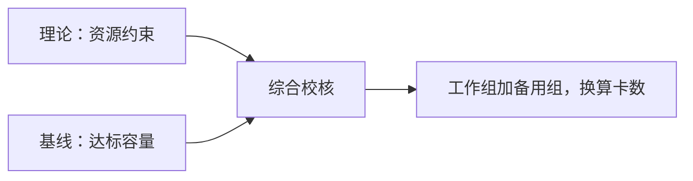

# 燃气设备巡检智能体算力测算说明

测算时间：2026-10-20 10:44（北京时间）。

> **仅流程演示：以下性能基线为模拟数据。**

**本次候选：32 张工作卡 + 16 张备用卡 = 48 张。**

理论测算尚未完成，本次结果为基线容量候选。

## 一、需求与部署条件

本次按以下业务负载和延迟目标核算。

| 项目 | 要求 |
| --- | --- |
| 模型 | DeepSeek-V4.1-Flash |
| 输入 / 输出 | 16,384 / 1,024 词元；固定长度 |
| 模型请求并发 | 100 路，增长预留 20% |
| 延迟目标 | TTFT ≤ 4,000 毫秒（P95）；TPOT ≤ 20 毫秒 / 词元（P95） |
| 负载口径 | 固定并发闭环压测；缓存命中率 0%；计入全部生成 Token |
| 备用与请求速率 | 1 个完整备用组；未提供持续请求速率 |

部署要求：A3-560T；W8A8C16；vLLM Ascend v0.30.0rc1；PD 分离；ARM。

## 二、计算规则

先做理论预算，再核算达标基线容量，最后统一口径形成建议。公式只说明关系，具体数值放在测算过程。

### 理论预算

> 显存需求 = 权重显存 + 规划并发 × 每请求缓存

根据模型参数、缓存结构、输入输出长度和 TTFT、TPOT 目标，确定同时满足显存、输入计算及生成计算约束的完整组数。采用有效能力，输入与生成分离部署时分别核对两侧资源。

### 基线容量与卡数

> 基线工作组数 = 向上取整［用户并发 × （1 + 增长比例） ÷ 基线达标并发］
>
> 候选总卡数 = （工作组数 + 备用组数） × 每组卡数

组数按完整配置取整；规划并发先向上取整。若另有持续请求速率要求，还须满足同一达标测试点的请求吞吐约束。理论与基线的卡数分别保留，综合时解释差异，不直接取平均或取最大值。

## 三、测算过程

### 理论测算

**理论测算尚未完成。** 当前缺少适用于本模型及部署方式的完整理论输入。

| 待补内容 | 用于核算 |
| --- | --- |
| 参数量与权重存储格式 | 权重显存及计算量 |
| 模型专属缓存预算与运行显存 | 每组请求容量 |
| 两侧部署资源与有效能力 | 输入、生成及完整组数量 |

配置检查：输入加输出 = 17,408 词元，声明上限 1,048,576 词元；未超过声明，部署支持仍需确认。

### 基线测算

采用 **id:DEMO-V41-001**：每组 16 卡，达标并发 64 路，保持原并行策略及输入 / 生成配比。

| 校验项 | 基线 | 用户要求 |
| --- | --- | --- |
| 输入 / 输出 | 16K / 1K | 16,384 / 1,024 词元 |
| TTFT | 3,886.1 毫秒（P95） | ≤ 4,000 毫秒（P95） |
| TPOT | 15.9 毫秒 / 词元（P95） | ≤ 20 毫秒 / 词元（P95） |

**工作配置**

> 规划并发 = 向上取整［100 × （1 + 20%）］ = 120 路
>
> 并发所需组数 = 向上取整［120 ÷ 64］ = 2 组
>
> 工作卡数 = 2 × 16 = 32 张

**含备用的总量**

> 候选总卡数 = （2 + 1） × 16 = **48 张**；其中备用 16 张。

其他记录的筛选结果如下，完整条件见附录。

| 基线记录 | 候选总量 | 采用或排除依据 |
| --- | ---: | --- |
| id:DEMO-V41-001 | 48 张 | 本次采用 |
| id:DEMO-V41-002 | 80 张 | 达标备选 |
| id:DEMO-V41-003 | 未采用 | 首 Token 延迟 = 5700.0 超过目标 4000.0；每 Token 耗时 = 25.0 超过目标 20.0 |
| id:DEMO-V41-004 | 48 张 | 达标备选 |
| id:DEMO-V41-005 | 64 张 | 达标备选 |
| id:DEMO-V41-006 | 未采用 | 用户至少一项长度超过基线，不能外推 |

## 四、综合建议

保留 **48 张卡** 作为基线候选，理论与部署校核完成后再定案。

同总卡数方案的工作能力和备用规模不同。

| 方案 | 工作卡 / 备用卡 | 工作组并发预算 |
| --- | --- | --- |
| id:DEMO-V41-001 | 32 / 16 | 2 × 64 = 128 路 |
| id:DEMO-V41-004 | 40 / 8 | 5 × 24 = 120 路 |

当前按输入顺序展示首个同等级、同卡数方案，未比较成本与故障域。

后续重点确认：

- 补齐理论参数与模型专属缓存预算，核验权重修订、量化及框架支持。
- 验证多组流量分配、持续负载及相同统计口径下的 TTFT、TPOT。
- 确认备用组故障域与切换能力；整机数量需有部署配置依据。

## 测算依据

引用的测试条件、核对口径、模型配置及文件摘要见[测算依据附录](customer-report.evidence.md)。
