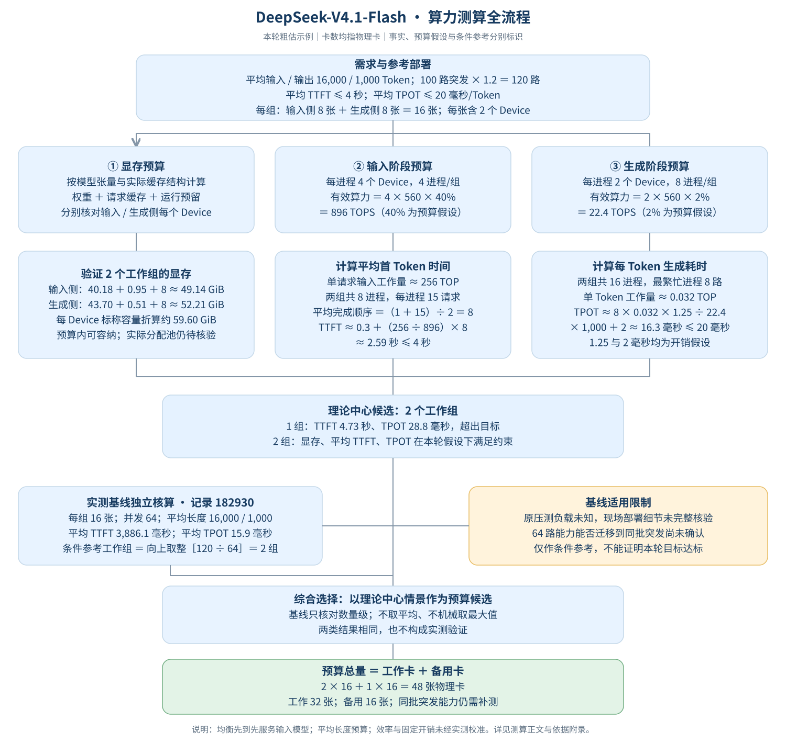

# 已确认的测算流程图示例

本图供模型查看结构与表现方式，客户报告须根据本轮结构化测算结果重新生成。

## 如何理解这张示例

顶部将100路并发与20%增长合为120路规划负载。中间分别核对逐Device显存、平均首Token时间和生成耗时，再说明一组不足、两组在预算假设下可行。基线182930独立计算组数；因其压测负载未知，只作条件参考。底部将32张工作卡与16张备用卡相加，形成48张物理卡的预算候选。

**该例不是后续项目的默认参数。** 输入40%、生成2%为授权粗估中的工程假设；48张未证明同批突发实测达标，不能迁移到其他模型或部署。示例图内包含必要数据与状态，可独立阅读。

生成新图前读取[绘图规范](../references/sizing-diagram.md)，按当前模型与部署选择公式。客户Markdown用相对图片链接嵌入生成后的SVG或PNG。
